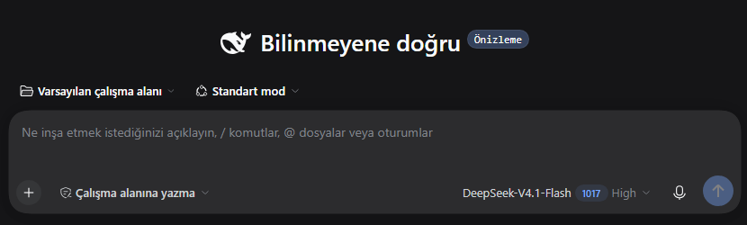
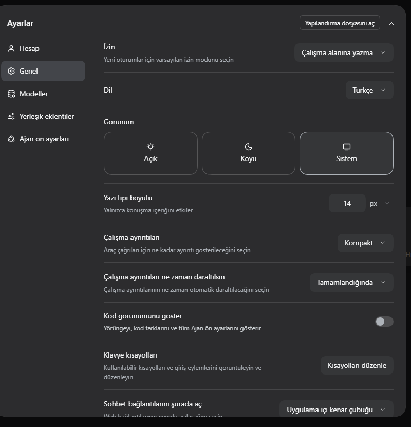

# dsh-turkish-locale

Turkish (**Türkçe**) language pack for the [DeepSeek Harness](https://github.com/deepseek-ai/deepseek-harness)
Web UI. A community plugin built on the documented client-plugin locale API —
no changes to the packaged application, no rebuild.



## What it does

- Registers `tr` with an `en` fallback through `ctx.locale.addLanguage` and
  `ctx.locale.register`.
- Translates **64 namespaces / 2,910 strings** — 100% of the English UI copy
  shipped in DSH **0.2.1-rc.3** (commit `be72761`). Placeholders, Markdown,
  separator strings and punctuation are preserved and validated against source.
- The language appears in **Settings → General → Language → Türkçe**; the choice
  persists as `locale.preference` in `cordis.patch.yml`, `<html lang>` follows the
  active locale, and English/Turkish switching works live in both directions.



## Install

The package is both a client plugin and a DSH **bundle** (`dsh.bundle.patch`), so
it can be installed manually or from a plugin market index.

### From the DSH plugin market (Discover)

Market index:

```
https://raw.githubusercontent.com/mkfeyman/dsh-turkish-locale/main/market-index.json
```

Add that URL as an index source in **Plugins → More → Discover** (Settings →
Plugins also lists the configured sources), then install "Türkçe dil paketi".
The installer pins
`git+https://github.com/mkfeyman/dsh-turkish-locale#<commit>`, so **Git** must be
available to pnpm on the machine.

### Manual install

1. Copy this package into a DSH profile's `node_modules`:

   ```powershell
   Copy-Item -Recurse dsh-turkish-locale "$HOME\\.dsh\\profiles\\desktop\\node_modules\\"
   ```

2. Add rows to the profile's `cordis.patch.yml`:

   ```yaml
   - insert:
       - id: tr-locale
         name: dsh-turkish-locale
   - id: locale
     config:
       preference: tr
   ```

3. With HMR enabled the pack activates in the running app; otherwise restart the
   app (or reload the Web GUI). Choose **Ayarlar → Genel → Dil** to switch.

## Repository layout

| Path | Purpose |
|---|---|
| `lib/client.js` | Browser bundle registering the language and dictionaries |
| `lib/index.js` | Empty host half (Loader row) |
| `cordis.patch.yml` | Bundle patch: adds the `tr-locale` row and defaults the locale to `tr` |
| `locales/tr.json` | Full namespace → key → Turkish dictionary data |
| `market-index.json` | Plugin market index listing this bundle (format 1) |
| `locale/` | Package-localized title/description |
| `docs/` | Screenshots and market icon |

## Provenance

The dictionaries were extracted from the English source of the client packages
installed with DSH 0.2.1-rc.3 and translated namespace by namespace; every
translated value was checked against its source placeholder set before the
bundle was generated. The proposal was shared with the DeepSeek Harness team in
[Discussions #11015](https://github.com/deepseek-ai/deepseek-harness/discussions/11015).

## License

MIT — see [LICENSE](LICENSE).
