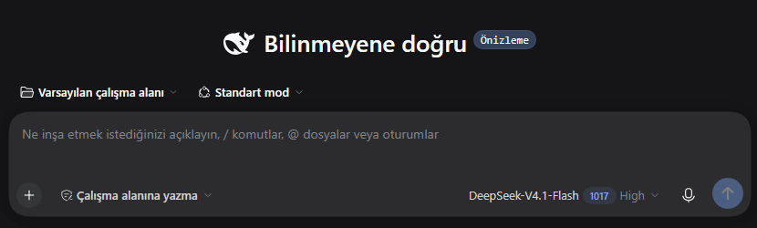
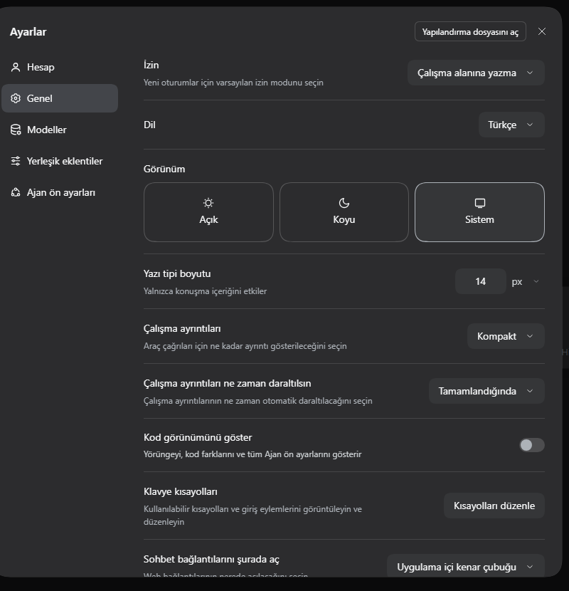
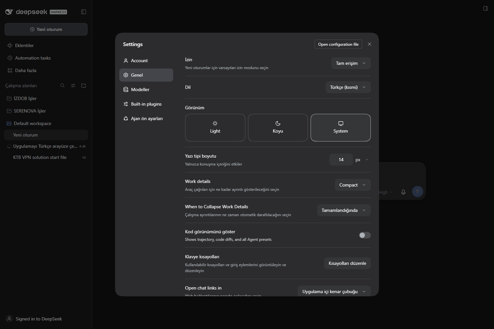

# dsh-turkish-locale

Turkish (**Türkçe**) language pack for the [DeepSeek Harness](https://github.com/deepseek-ai/deepseek-harness)
Web UI. A community plugin built on the documented client-plugin locale API —
no changes to the packaged application, no rebuild.



## What it does

- Registers `tr` with an `en` fallback through `ctx.locale.addLanguage` and
  `ctx.locale.register`.
- Translates **73 namespaces / 3,838 strings** — 100% of the English UI copy
  shipped in DSH **0.2.2-rc.1** (commit `c59d10a`; v1.1.0). Placeholders,
  Markdown, separator strings and punctuation are preserved and validated
  against source.
- The language appears in **Settings → General → Language → Türkçe**; the choice
  persists as `locale.preference` in `cordis.patch.yml`, `<html lang>` follows the
  active locale, and English/Turkish switching works live in both directions.



## Install

The package is both a client plugin and a DSH **bundle** (`dsh.bundle.patch`), so
it can be installed manually or from a plugin market index.

### From the DSH plugin market (Discover)

Market index:

```
https://raw.githubusercontent.com/mkfeyman/dsh-turkish-locale/main/market-index.json
```

Add that URL as an index source in **Plugins → More → Discover** (Settings →
Plugins also lists the configured sources), then install "Türkçe dil paketi".
The installer pins
`git+https://github.com/mkfeyman/dsh-turkish-locale#<commit>`, so **Git** must be
available to pnpm on the machine.

### Manual install

1. Copy this package into a DSH profile's `node_modules`:

   ```powershell
   Copy-Item -Recurse dsh-turkish-locale "$HOME\\.dsh\\profiles\\desktop\\node_modules\\"
   ```

2. Add rows to the profile's `cordis.patch.yml`:

   ```yaml
   - insert:
       - id: tr-locale
         name: dsh-turkish-locale
   - id: locale
     config:
       preference: tr
   ```

3. With HMR enabled the pack activates in the running app; otherwise restart the
   app (or reload the Web GUI). Choose **Ayarlar → Genel → Dil** to switch.

## Compatibility

- Verified working on **DSH 0.2.2-rc.1** (commit `c59d10a`): the pack loads from
  the boot graph, the selector lists 8 built-in languages plus Türkçe, switching
  round-trips, and `locale.preference: tr` persists. Runtime contracts
  (`addLanguage`, `register(ns, locale, dict)`, `resolveText`, snapshot) are
  unchanged from 0.2.1-rc.3. See
  [`docs/upgrade-analysis-0.2.2-rc1.md`](docs/upgrade-analysis-0.2.2-rc1.md).
- **Coverage (v1.1.0):** re-extracted from 0.2.2-rc.1 and translated to
  **73 namespaces / 3,838 strings — 100 %** of the shipped English UI copy,
  including the 981 strings added by 0.2.2 (10 new namespaces:
  `forgePanel` 253, `liveshare` 225, `stats` 177, …). The 60 changed English
  source values were reviewed and updated where the meaning moved. Measured
  delta and fixture notes: [`fixtures/version-coverage.json`](fixtures/version-coverage.json).
  Release notes: [`docs/release-notes-v1.1.0.md`](docs/release-notes-v1.1.0.md).

## Repository layout

| Path | Purpose |
|---|---|
| `lib/client.js` | Browser bundle registering the language and dictionaries |
| `lib/index.js` | Empty host half (Loader row) |
| `cordis.patch.yml` | Bundle patch: adds the `tr-locale` row and defaults the locale to `tr` |
| `locales/tr.json` | Full namespace → key → Turkish dictionary data |
| `market-index.json` | Plugin market index listing this bundle (format 1) |
| `fixtures/` | Deterministic 59.4 % Turkish subset + expected ordered-lookup samples |
| `patches/` | Draft patch for [ordered locale preference (#11699)](https://github.com/deepseek-ai/deepseek-harness/discussions/11699) |
| `locale/` | Package-localized title/description |
| `docs/` | Screenshots and market icon |

## Ordered locale preference (Discussion #11699)

The community proposal to replace the single UI locale with an ordered
preference list (`ru → en → zh`) is supported by this pack. We published:

- **Patch draft** for `packages/client/locale`, now rebased to
  **`dsh-v0.2.2-alpha.2`** (the tag that ships six additional built-in
  dictionaries): [`patches/0002-ordered-locale-preference-0.2.2.patch`](patches/0002-ordered-locale-preference-0.2.2.patch)
  (11 files; legacy `string` preferences read as one-element lists; `snapshot.active`
  stays the first entry; lookup expands each preferred language's fallback chain
  and ends at English; reorderable settings row). The `dsh-v0.2.1-rc.3` variant
  remains at [`patches/0001-ordered-locale-preference.patch`](patches/0001-ordered-locale-preference.patch).
  Hunks were self-checked, and the patched runtime was executed against the
  fixture in a stub harness (**17/17 semantic checks**, 10/10 files
  syntax-checked — see
  [`patches/validation-report-0.2.2.json`](patches/validation-report-0.2.2.json)
  and the rc.3 [`validation-report.json`](patches/validation-report.json)); it has
  **not** been built with the repository toolchain yet.
- **Fixture** to exercise it: [`fixtures/`](fixtures/README.md) — a 59.4 %
  Turkish subset (1728 / 2910 keys) plus `expected-behavior.json` samples for
  `["tr","en"]`, `["en","tr"]`, `["tr","zh"]` and the legacy single selection;
  `version-coverage.json` records why the 0.2.2 delta (9 namespaces / 853 strings)
  falls through to English in fixture tests.
- **Layer-2 audit:** [`tools/audit_locale_gaps.py`](tools/audit_locale_gaps.py)
  measures the case ordering cannot fix — namespaces that register only `zh` and
  CJK keys that would leak as raw text — from a local dictionary dump
  (`{namespace: {locale: {key: value}}}`). Sample: [`fixtures/audit-sample.json`](fixtures/audit-sample.json).
  Classification confirmed with `@ragnoryok1`: typed (zh+en) dictionaries are
  fixed by ordering; per-locale `zh`-only dictionaries are not, and a tarball
  listing cannot distinguish them, so the rule belongs at registration time.
- **Live demo:** the fixture was installed as a temporary `tr-partial` language
  pack and selected in Settings → General → Language, rendering a mixed
  Turkish/English UI (screenshot below). The demo pack was removed afterwards.



The Turkish pack is unaffected by the change: `tr → en` behaves exactly like the
ordered list `["tr","en"]`.

## Provenance

The dictionaries were extracted from the English source of the client packages
installed with DSH 0.2.1-rc.3 and translated namespace by namespace; every
translated value was checked against its source placeholder set before the
bundle was generated. The proposal was shared with the DeepSeek Harness team in
[Discussions #11015](https://github.com/deepseek-ai/deepseek-harness/discussions/11015).

## License

MIT — see [LICENSE](LICENSE).
