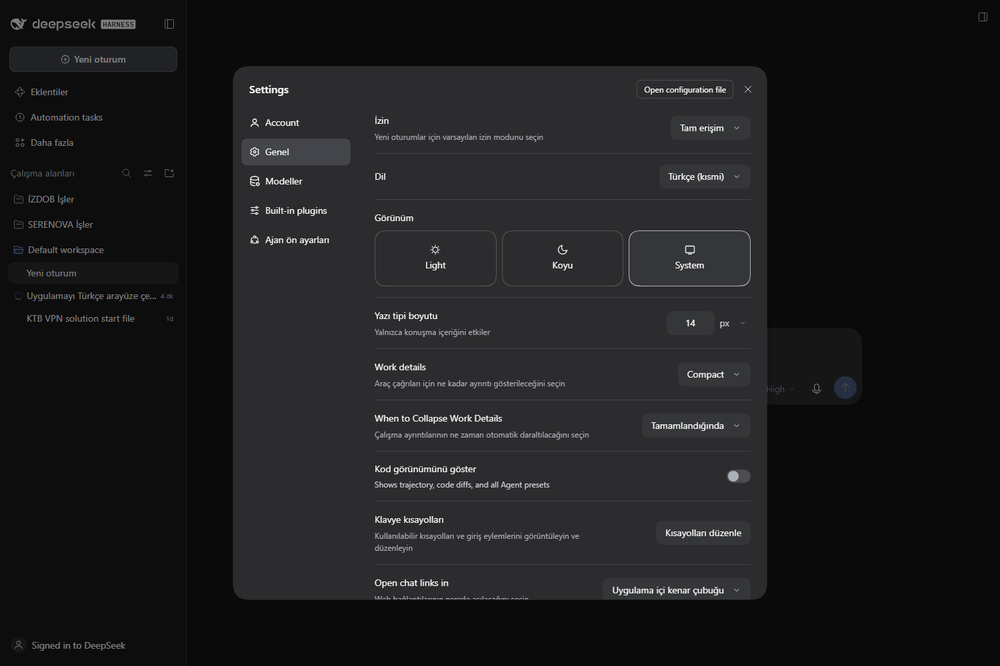

# Ordered-locale fixtures

Fixture data for the ordered locale preference proposal
([Discussion #11699](https://github.com/deepseek-ai/deepseek-harness/discussions/11699))
and the draft patch in [`../patches/`](../patches/README.md).

## Files

| File | Purpose |
|---|---|
| `tr-partial.json` | Deterministic **59.4 %** subset of the Turkish dictionaries (`1728 / 2910` keys, 64 namespaces), same shape as the language pack's `locales/tr.json`. Generated by `tools/make_tr_partial_fixture.py` in the project workspace. |
| `expected-behavior.json` | Coverage summary, the chains compared, and sample keys with the value each chain returns. |

## What it demonstrates

- **Partial packs become useful.** With `preference: ["tr"]` today the missing
  ~40 % falls through to `en`; with an ordered list the same fallback applies but
  the user controls the order, e.g. `["tr", "en"]` (Turkish first, English
  islands) versus `["en", "tr"]` (English everywhere).
- **Order is meaningful.** A key that both dictionaries own answers from the
  first entry: `["tr", "en"]` → Turkish, `["en", "tr"]` → English.
- **No Chinese leakage for this pack.** `tr` declares `en` as its fallback, so a
  missing Turkish key reaches English before any other language; adding `zh` to
  the list only matters for namespaces where English is absent.

`expected-behavior.json` records the exact values for the samples so a test can
assert both behaviours:

```json
{
  "chains": {
    "today (single preference, language fallback)": ["tr", "en"],
    "ordered [tr, en]": ["tr", "en"],
    "ordered [en, tr]": ["en", "tr"],
    "ordered [tr, zh]": ["tr", "zh", "en"],
    "ordered [ru, en, zh]": ["ru", "en", "zh"]
  }
}
```

## Live demo

The fixture was also built into a temporary language pack (`tr-partial`,
label `Türkçe (kısmi)`) and installed in DSH 0.2.1-rc.3. Selecting it in
**Settings → General → Language** renders the mixed UI directly — Turkish where
the subset has a key, English islands where it falls back:



The demo pack was removed afterwards; the fixture and this screenshot remain.

## Using it in tests

The fixture is plain dictionary data; a test can load it and register the
subsets as a language-pack plugin:

```ts
const partial = JSON.parse(await readFile(new URL('./tr-partial.json', import.meta.url), 'utf8'))
for (const [ns, dict] of Object.entries(partial)) locale.register(ns, 'tr', dict)
locale.addLanguage({ id: 'tr', label: 'Türkçe', fallback: 'en' })
locale.setPreferences(['tr', 'en'])
```

To reproduce the currently shipped single-selection behaviour, call
`locale.setLocale('tr')` instead and compare the rendered strings.
